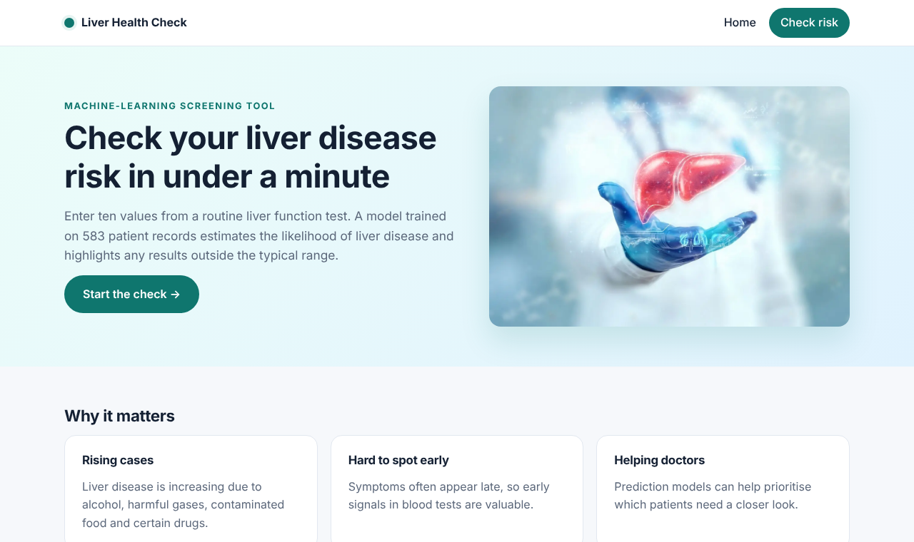
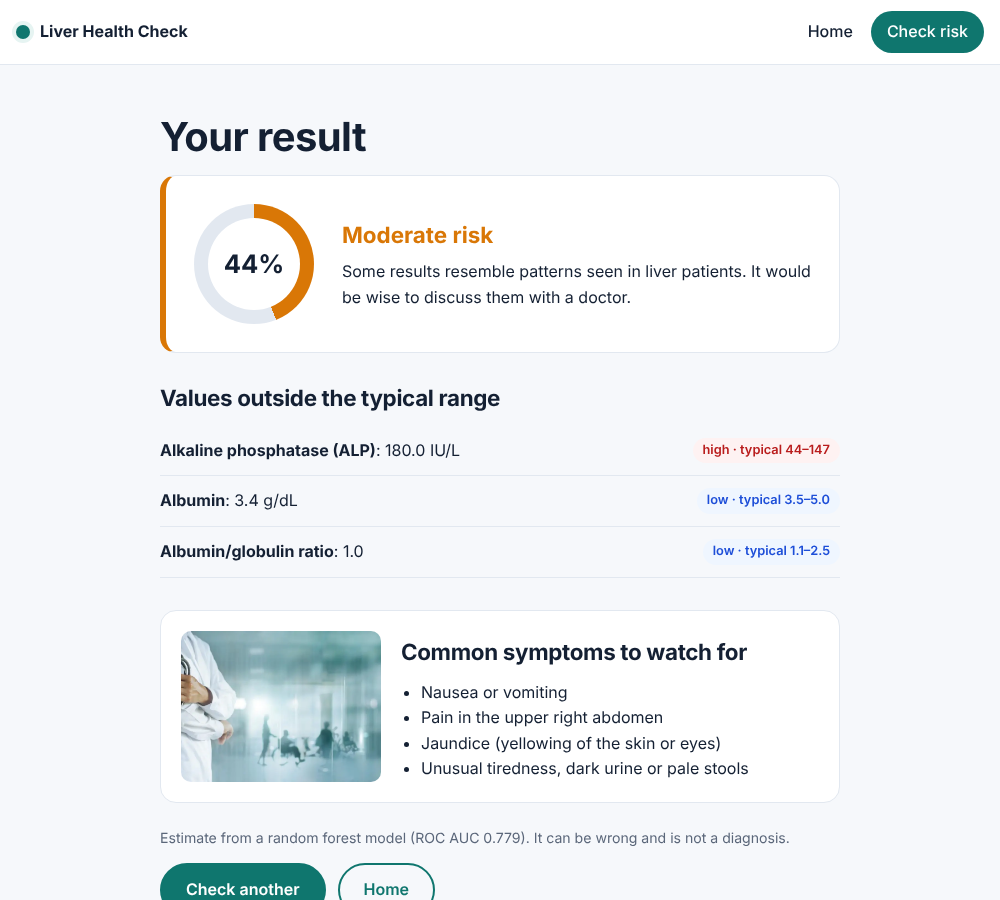

# Liver Health Check

**Machine-learning web app that estimates liver disease risk from a routine blood test.** Enter ten values from a liver function test (LFT). The app returns a risk percentage, a low / moderate / high rating, and a list of results outside the typical range.


| Home | Result |
|---|---|
|  |  |

> **Not medical advice.** This is a student project for learning. It does not diagnose anything. Always consult a doctor.

## Contents

- [Features](#features)
- [How the model works](#how-the-model-works)
- [Getting started](#getting-started)
- [Using the app](#using-the-app)
- [API](#api)
- [Retraining the model](#retraining-the-model)
- [Running tests](#running-tests)
- [Deployment](#deployment)
- [Project structure](#project-structure)
- [Changes from the original version](#changes-from-the-original-version)
- [Team](#team)

## Features

- **Risk gauge:** the model's probability shown as a percentage, with a low / moderate / high rating
- **Out-of-range flags:** every value above or below the typical adult range is listed
- **Helpful form:** units and typical ranges under each field, a "Fill sample values" button, and clear error messages
- **Server-side validation:** missing, non-numeric and impossible values are rejected
- **JSON API** for use from other programs
- **Reproducible training:** one script compares three models and saves the best one with its scores
- **Responsive design** for phones and desktops
- **Automated tests** with pytest

## How the model works

| | |
|---|---|
| **Dataset** | [Indian Liver Patient Dataset](https://archive.ics.uci.edu/dataset/225/ilpd+indian+liver+patient+dataset) (UCI): 583 patients, 416 with liver disease and 167 without |
| **Preprocessing** | Missing values filled with the median; skewed lab values log-transformed; all features standardised |
| **Models compared** | Logistic regression, random forest and gradient boosting, using 5-fold cross-validation |
| **Chosen model** | Random forest with balanced class weights |

### Results on a held-out test set (20% of patients)

| Metric | Score | Meaning |
|---|---|---|
| ROC AUC | **0.78** | How well the model ranks sick patients above healthy ones (0.5 = guessing, 1.0 = perfect) |
| Accuracy | 69% | Share of patients classified correctly |
| Precision | 80% | Of patients flagged as at risk, how many had liver disease |
| Recall | 76% | Of patients with liver disease, how many were flagged |

Full numbers are in [`model/metrics.json`](model/metrics.json).

**Risk levels:** below 40% is *low*, 40–70% is *moderate*, and 70% or above is *high*.

### Inputs

| Field | Unit | Typical adult range |
|---|---|---|
| Age | years | |
| Gender | male / female | |
| Total bilirubin | mg/dL | 0.1–1.2 |
| Direct bilirubin | mg/dL | 0–0.3 |
| Alkaline phosphatase (ALP) | IU/L | 44–147 |
| ALT (SGPT) | IU/L | 7–56 |
| AST (SGOT) | IU/L | 10–40 |
| Total proteins | g/dL | 6.0–8.3 |
| Albumin | g/dL | 3.5–5.0 |
| Albumin/globulin ratio | | 1.1–2.5 |

## Getting started

### Requirements

- Python 3.10 or newer

### Install and run

```bash
git clone https://github.com/SathvikRinny/Liver_Paitent_Analysis_NexsuProject_3s.git
cd Liver_Paitent_Analysis_NexsuProject_3s

python -m venv .venv
source .venv/bin/activate        # Windows: .venv\Scripts\activate
pip install -r requirements.txt

python app.py
```

Open http://127.0.0.1:5000.

| Environment variable | Default | Purpose |
|---|---|---|
| `PORT` | `5000` | Port to listen on |
| `FLASK_DEBUG` | off | Set to `1` for auto-reload and debug pages while developing |

## Using the app

1. Click **Check risk** (or **Start the check**).
2. Enter the values from your report, or click **Fill sample values** to try it.
3. Click **Predict** to see the risk gauge, the out-of-range values, and symptoms to watch for.

## API

`POST /api/predict` with a JSON body. `Gender` accepts `"male"`, `"female"`, `1` or `0`.

```bash
curl -X POST http://127.0.0.1:5000/api/predict \
  -H "Content-Type: application/json" \
  -d '{
        "Gender": "male", "Age": 45,
        "Total_Bilirubin": 0.9, "Direct_Bilirubin": 0.2,
        "Alkaline_Phosphotase": 180, "Alamine_Aminotransferase": 35,
        "Aspartate_Aminotransferase": 38, "Total_Protiens": 6.9,
        "Albumin": 3.4, "Albumin_and_Globulin_Ratio": 1.0
      }'
```

**Success (200)**

```json
{
  "probability": 0.443,
  "risk": "moderate",
  "out_of_range": [
    { "label": "Alkaline phosphatase (ALP)", "value": 180.0, "unit": "IU/L", "range": "44–147", "direction": "high" },
    { "label": "Albumin", "value": 3.4, "unit": "g/dL", "range": "3.5–5.0", "direction": "low" },
    { "label": "Albumin/globulin ratio", "value": 1.0, "unit": "", "range": "1.1–2.5", "direction": "low" }
  ]
}
```

**Invalid input (400)**

```json
{ "errors": { "Age": "Please enter a number.", "Gender": "Please choose a gender." } }
```

## Retraining the model

```bash
python train.py
```

This reads `data/indian_liver_patient.csv`, prints each model's cross-validation score, evaluates the best one on the test set, retrains it on all the data, and saves `model/liver_model.joblib` and `model/metrics.json`. The app picks up the new model the next time it starts.

## Running tests

```bash
pip install pytest
pytest
```

The tests check that the pages load, that higher-risk values get a higher probability, that the form shows results, and that bad input is rejected.

## Deployment

`gunicorn` is included in `requirements.txt`. On a host such as Render or Railway, use:

```bash
gunicorn app:app
```

## Project structure

```
app.py                  Flask app: routes, validation, prediction
train.py                Model training and evaluation
model/
  liver_model.joblib    Trained model
  metrics.json          Scores and settings of the trained model
data/
  indian_liver_patient.csv
templates/              HTML pages (Jinja2): base, index, predict, result, 404
static/
  css/style.css         Styles
  img/                  Images
tests/test_app.py       Automated tests
docs/                   Screenshots
requirements.txt        Python dependencies
```

## Changes from the original version

The first version of this project, from a 2022 internship, had bugs that made its predictions meaningless:

- The result page checked a misspelled variable (`predition`), so it **always** said "No worries".
- During training, every patient was recorded as female because the code compared `'male'` with `'Male'`.
- The model was an SVM trained on unscaled data, which flagged almost everyone as having liver disease.
- The HTML and CSS files were not in the `templates/` and `static/` folders, so Flask could not find them.

All of these are fixed in this version.

## Team

P. Sathvik Raju · R. Varun · S. Sai Revanth · H. N. Vinay Reddy

Maintained by **Sathvik Raju Pothureddy**: [GitHub](https://github.com/SathvikRinny) · [LinkedIn](https://www.linkedin.com/in/sathvik-raju/)
